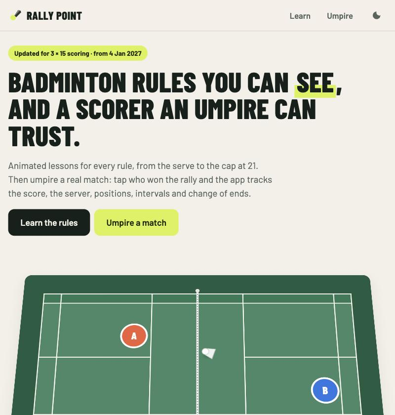

# Rally Point

**Live:** https://rally-point-7484b.web.app

A badminton web app in three parts: animated lessons on the rules, an umpire's scorer for real
matches, and a small rally game against the computer. No build step, no framework, and it runs
entirely on Firebase's free plan.



## What it does

- **Learn**: 12 animated, interactive lessons on the rules: the court, rally scoring, winning a game, serving in singles and doubles, a legal serve, the four types of serve, in or out, faults, lets, intervals and changing ends, and a "who serves next?" quiz.
- **Umpire**: score a real singles or doubles match. Tap the side that won the rally. The app tracks the score, server and receiver, everyone's position on court, the umpire's call, intervals with countdowns, change of ends, undo, a rally log and a history of finished matches. A **live link** lets spectators follow the score on their phones.
- **Play**: a side-on rally game against the computer, in singles or doubles. Arrow keys move, Space swings (hold and release to serve), with on-screen buttons on phones. The score, who serves, service courts and faults (short or long serves, feet moving on the serve, net, out) come from the same scoring engine as the umpire.

Scoring defaults to the BWF **3 × 15** system (first to 15, two clear from 14 all, capped at 21, interval and third-game change of ends at 8), which becomes the standard on 4 January 2027. The classic **3 × 21** system is still available as an option.

## How it is built

- **One scoring engine, three uses.** `engine.js` holds the rules as pure functions with unit tests. The umpire screen, the court animations and the game all call it, so a rule change is made and tested in one place.
- **Real court geometry.** `court.js` draws the court in SVG at its real dimensions in metres, and `scene.js` turns a match state into player positions.
- **Live links without a backend.** Spectators follow a match through Cloud Firestore, with anonymous Firebase Authentication and security rules that let only the umpire's device write.
- **Works offline.** A service worker caches the app, and it installs on a phone like a native app. Only live links need a connection.
- **No keys in the code.** The app reads its Firebase config from Hosting's reserved `/__/firebase/init.json` URL.
- **Free to run.** Firebase Hosting, Firestore and Authentication on the Spark plan; the whole app is well under 1 MB.

Built with AI-assisted development, in plain JavaScript, HTML and CSS.

## Project layout

```
public/            the whole site (no build step)
  index.html       app shell
  styles.css       all styling, light and dark themes
  app.js           routing, home page, lesson pages
  engine.js        scoring rules (pure functions, unit-tested)
  court.js         animated SVG court, real dimensions in metres
  scene.js         turns a match state into player positions
  lessons.js       the Learn lessons
  umpire.js        umpire setup, match screen, spectator view
  play.js          the Play section: a side-on rally game against the computer
  live.js          Firestore live links (loaded only when used)
  sw.js            offline cache
  manifest.webmanifest, icons/
test/engine.test.js  unit tests for the scoring rules
firebase.json      Hosting + Firestore config
firestore.rules    who can read/write live matches
scripts/setup-firebase.sh  one-off project creation and first deploy
.firebaserc        which Firebase project to deploy to
```

## Routine tasks

You need Node.js 20 or later. The Firebase CLI runs through `npx`, so nothing has to be installed globally.

### Run it locally

```
npm run serve
```

Then open http://localhost:5050. Everything works locally except live links, which need the deployed site.

### Run the tests

```
npm test
```

### Deploy a change

```
npm run deploy
```

This deploys the site, the Firestore rules and indexes to the project in `.firebaserc`.

To deploy only the site: `npx firebase-tools@15 deploy --only hosting`.

### After changing any file in `public/`

Bump the cache name in `public/sw.js` (for example `rally-point-v1` to `rally-point-v2`) so phones that installed the app pick up the new version.

### Change the scoring rules

All rules live in `public/engine.js`. The two systems are in `SYSTEMS` at the top (target, cap, interval). Add a test in `test/engine.test.js` for any rule change and run `npm test`.

## First-time Firebase setup

Run this once from the project folder:

```
npm run setup
```

`scripts/setup-firebase.sh` does the whole setup:

1. Checks which Google account the Firebase CLI is signed in with (it opens a browser to sign in if needed) and asks you to confirm.
2. Creates a new project called `rally-point-xxxxx` on the free Spark plan and saves its id in `.firebaserc`.
3. Creates the Firestore database in London (`europe-west2`).
4. Deploys the site, the Firestore rules and anonymous sign-in. Anonymous sign-in is switched on by the `auth` section of `firebase.json`.

It is safe to run again. If `.firebaserc` already exists it reuses that project.

The app reads its Firebase config from Hosting's reserved URL `/__/firebase/init.json`, so no keys are stored in the code.

## Free plan limits that matter

- Hosting: 10 GB stored, 360 MB a day of downloads. The whole app is well under 1 MB.
- Firestore: 50,000 reads and 20,000 writes a day. A live match writes once per rally (roughly 60 to 120 writes) and each spectator reads once per rally.
- On Spark, hitting a limit pauses that service until the next day. There is no bill.

## Licence

MIT. See [LICENSE](LICENSE).
